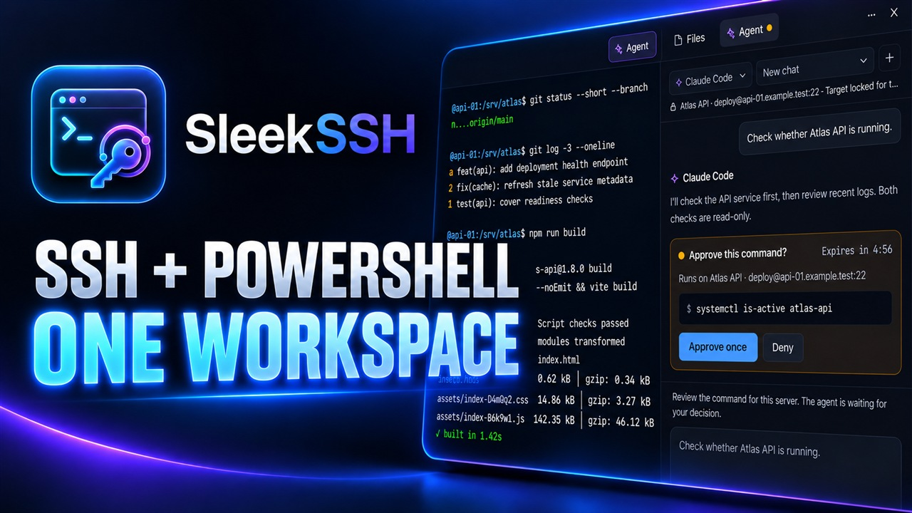
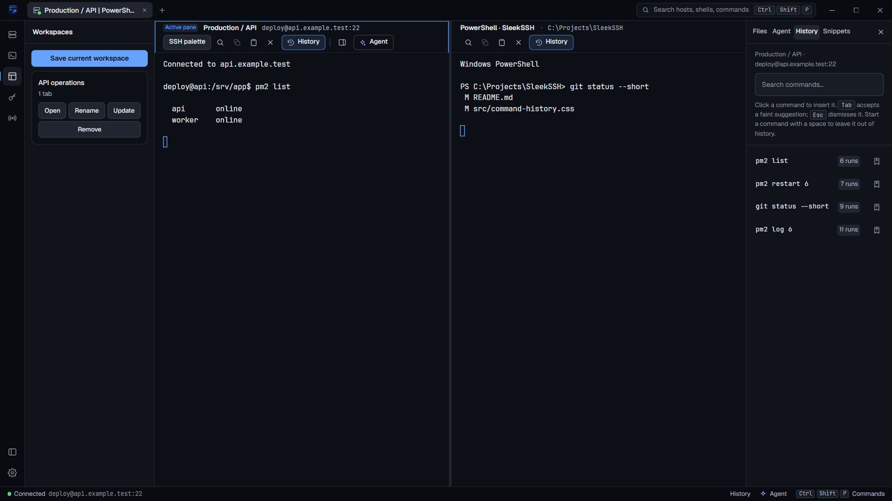
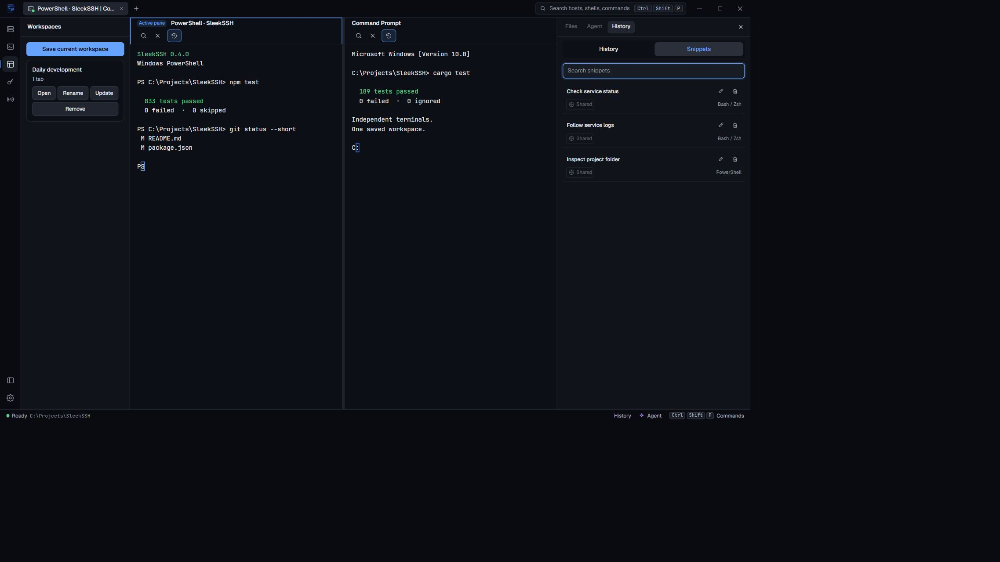
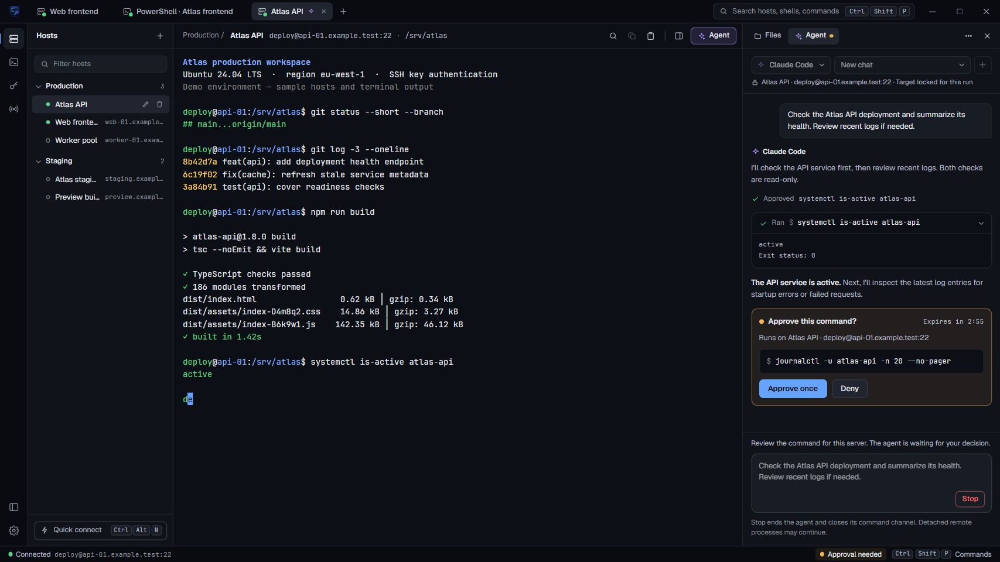
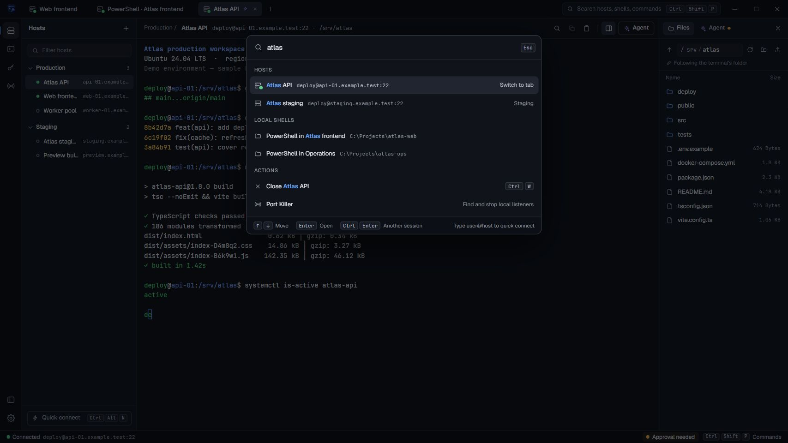

# SleekSSH

A Windows desktop workspace for SSH sessions, local terminals, SFTP, and command-by-command Claude Code or Codex automation.

<!-- Documentation owner: repository maintainers. Reviewed for v0.4.0 on 2026-11-02; review on every release. -->

## Quick start

**v0.4.0 is unreleased.** To try the features documented below, build this branch using [Development](#development). The latest published Windows installers are v0.3.0.

1. Install **SleekSSH v0.3.0** for Windows x64: [MSI installer](https://github.com/thechandanbhagat/sleek-ssh/releases/download/v0.3.0/SleekSSH_0.3.0_x64_en-US.msi) or [EXE installer](https://github.com/thechandanbhagat/sleek-ssh/releases/download/v0.3.0/SleekSSH_0.3.0_x64-setup.exe).
2. Launch SleekSSH. In **Local shells**, open PowerShell or Command Prompt; use **Hosts** to add an SSH profile with your server, username, and password or private key.
3. For a new SSH server, compare its displayed fingerprint with a trusted source before accepting it.

While SleekSSH is running, **Ctrl+Alt+T** brings it forward and opens PowerShell. The app registers itself to launch at Windows startup.

See the [release notes](RELEASE_NOTES.md) and [all releases](https://github.com/thechandanbhagat/sleek-ssh/releases).

## Demo video

[](https://www.youtube.com/watch?v=3Km52Ny7FfY)

A two-minute narrated product demo with animated UI, saved PowerShell locations, remote files, and command approval, using fictional demo data.

[Watch on YouTube](https://www.youtube.com/watch?v=3Km52Ny7FfY) | [Download the MP4](https://github.com/thechandanbhagat/sleek-ssh/releases/download/v0.3.0/sleekssh-product-demo-v0.3.0-final.mp4)

## Screenshots

These v0.4.0 previews render the current interface with fictional terminal output and saved data; they do not connect to real servers or run commands.



Split terminals keep independent sessions in one tab. Workspaces restore their layout, and History follows the focused pane.



The Snippets library keeps named command templates ready for parameter entry and review.

The Agent and global command palette screenshots below show v0.3.0 with fictional hosts, files, and agent responses.



The Agent panel shows command results and waits for explicit approval before running the next command. Each SSH session has its own draft, chat context, output, approvals, and Stop control. Agents on different sessions can run concurrently; switching tabs or panes never changes a running agent's target. A local chat attached to one SSH session cannot be reused in another session.



Press **Ctrl+Shift+P** to search hosts, saved PowerShell folders, and workspace tools.

## Your workspace

- **SSH and local terminals:** Keep remote sessions, PowerShell, and Command Prompt in separate tabs. Reconnect a disconnected SSH session from its terminal toolbar.
- **Split view:** Use **Split right** or **Split below** in a terminal toolbar or the command palette, then choose another SSH host, local shell, or saved PowerShell folder. Each tab supports two independent panes. Drag the divider to resize, or focus the divider and use arrow keys; **Ctrl+Alt+Arrow** switches pane focus. **Close pane** / **Ctrl+Alt+W** closes only that pane; **Ctrl+W** closes the whole tab. History, snippets, Files, and new Agent tasks follow the focused pane. Snippet previews show the pane number and expire when focus changes. Saved workspaces remember both panes, direction, size, and focus; older single-pane workspaces still open.
- **Saved PowerShell locations:** In **Local shells → Saved locations → Add location**, choose or enter a folder and save it with an optional name. Click the saved location to open PowerShell in that folder. Locations are remembered between app launches and can be edited or removed.
- **Saved workspaces:** Open **Workspaces → Save current workspace** to name your open SSH hosts and local terminals. Reopen the saved set from Workspaces or the command palette, restoring tab order, the active tab, local launch folders, remote folders, sidebar and Files widths/visibility, and the selected Files, History, or Agent panel. Existing tabs stay open; restored tabs are appended. Rename changes the label, Update replaces the saved set with your current tabs/layout, and Remove deletes only the saved workspace. Save quick-connect hosts in Hosts first; Settings and Ports tabs are excluded. Workspaces store host references, never credentials, and start fresh terminal sessions without resuming processes or agent tasks. Missing hosts, folders, and connection failures are reported individually while other tabs continue opening.
- **Hosts and layout:** Organize saved hosts in nested folders and filter them by name or address. Clicking a host that is already open switches to its tab; **Ctrl+click** opens another session. Folder collapse state, sidebar width, and SFTP pane width are remembered.
- **Command palette:** Press **Ctrl+Shift+P**, or click the search box in the title bar, to jump to hosts, shells, and tools. Type `user@host` or `user@host:port` to connect without saving; **Ctrl+Alt+N** opens the palette in quick connect mode.
- **SSH session palette:** Press **Ctrl+Shift+K** in an SSH session, or click **SSH palette** in its toolbar, to find that host's saved folders and shared snippets. **Save current folder** adds a named location, with an option to start future connections there. The global palette stays on **Ctrl+Shift+P**.
- **Snippet scope:** Click a snippet's **Shared** badge to limit it to the current SSH server and folder, including subfolders. Click **Folder** to make it shared again. Folder snippets appear before shared snippets in the SSH palette; existing snippets stay shared.
- **Terminal controls:** Copy with **Ctrl+Shift+C**, paste with **Ctrl+Shift+V**, and search with **Ctrl+F**. A context menu also provides copy, paste, and selection controls.
- **Command history:** Open **History** from the terminal toolbar or status bar to search commands and their run counts. Terminal and agent commands share history for each server; local history is grouped by shell and survives restarts. Click a command to insert it without running it.
- **Named snippets:** Choose **Save as snippet** on a history command, give it a name, and replace arguments with parameters such as `systemctl status {{service}}`. Open **History → Snippets**, or **Named snippets** in the command palette, to search, edit, or remove saved templates. Choose **Use**, fill in the parameters, and **Review command** to see the exact command, terminal, and shell mode. **Insert** fills the prompt; **Run** sends it with Enter. Both require an empty, ready prompt and a current preview. Changing tabs, reconnecting, editing parameters, or typing in the terminal expires the preview. Snippets persist locally; parameter values are not saved with them, though executed commands may appear in history.
- **Inline suggestions:** As you type at a shell prompt, matching history appears in faint text. **Tab** accepts the suffix; **Esc** dismisses it. Normal shell Tab completion remains available when no suggestion is visible. Start a command with a space to exclude it from history.
- **SFTP:** Browse remote directories, upload and download files through native file dialogs, create folders, and delete remote files or directories.
- **SSH keys:** Discover private keys in `~/.ssh`, select a custom key, or generate a new keypair.
- **Optional Cisco VPN:** Enable **Cisco VPN switcher** in Settings; it is hidden by default. With Cisco Secure Client or AnyConnect installed, import profile shortcuts, switch connections, disconnect, and check status.

Saved connection and VPN credentials use Windows DPAPI encryption. SSH server trust is checked before authentication; a changed host key blocks the connection and displays both the saved and presented fingerprints.

Automatic history supports Bash, Zsh, PowerShell, and single-line Command Prompt input. Bash versions older than 4.4 can record only commands retained by native shell history, so suppressed duplicates cannot be counted there. Multiline commands remain visible for reference; review and copy their text when needed. Password prompt responses and recognized inline credentials are excluded from history.

Snippet templates are single-line commands. Put each `{{parameter}}` in a separate, unquoted argument and select the shell currently running in the terminal. Bash/Zsh and PowerShell values are quoted as literal arguments. Command Prompt parameters accept simple values without spaces or shell operators. Parameterized templates reject unsupported expression contexts; the editor reports these before saving.

### Saved sudo password

Edit a connection, save a **separate sudo password**, enable its shortcut, and reconnect. At a recognized standard Bash/Zsh sudo password prompt, press **F2 three times within two seconds** to submit it. The password is encrypted with Windows DPAPI.

## Claude Code and Codex automation

### Start a task

1. Install and authenticate Claude Code or Codex locally before starting SleekSSH. Use **Refresh** after installing a CLI; restart SleekSSH after changing PATH.
2. Connect to an SSH server, select its terminal tab, and open **Agent** from the session toolbar or the status bar.
3. Choose the provider, enter your task, and select **Run task** (or press **Enter**). Use **Shift+Enter** to add a new line.
4. Review every proposed remote command and choose **Approve once** or **Deny**.

The CLI runs locally with its configured authentication; SleekSSH adds no OAuth sign-in. Neither CLI needs installing on the remote server, and SSH credentials are not passed to the CLI. This integration was verified with Claude Code **2.1.268** and Codex CLI **0.154.0**; older versions without the required isolation flags need updating.

Agent responses support Markdown headings, lists, tables, links, and code blocks. Remote command output stays literal and monospaced. Web and email links open in their default application; embedded HTML is displayed as text and images are not fetched.

While a task runs, keep typing follow-ups and choose **Queue prompt** (**Enter**). Up to 20 prompts run in order in the same SSH session and chat after successful completion. Reorder or remove pending prompts, or use **Pause queue** / **Resume queue**. Failures, Stop, and connection changes pause the queue; reconnecting requires explicit resumption.

Queued prompts appear as compact strips above the input. Use **Steer** to run an existing queued instruction next, the trash button to remove it, or **More options** to move it earlier or pause/resume the queue.

**Steer now** (**Ctrl+Enter**) stops the current task and continues the same chat with the new instruction ahead of queued work. It becomes available after the CLI returns a conversation ID. This is stop-and-continue steering; it does not inject input into the running CLI. After completion, **Send follow-up** continues the chat directly. Every remote command still requires approval.

### Resume local chats

Choose an idle saved conversation from **Local chat**, or select **New chat**. The list follows the selected provider and shows titles, project paths, and update times, newest first. **Refresh chats** reloads local metadata; **Advanced** allows manual UUID entry.

SleekSSH stores the CLI's returned conversation ID per SSH session and provider and resumes it for later tasks. **New chat** clears that association without deleting CLI history. A saved ID remains selectable when absent from the latest listing. SleekSSH also saves a bounded local transcript for each chat, including displayed command results, and uses a stable local application-data workspace. Opening an existing CLI chat without a saved transcript loads its recent user and assistant messages from local CLI history.

Discovery reads metadata without starting a CLI, calling a model, or loading full conversations. Lists are limited to 200 chats, with a notice when discovery is partial. Use a conversation that is idle in other terminals. Resumption uses `claude --print --resume <UUID>` or `codex exec ... resume <UUID> -`; SleekSSH supplies its SSH bridge and command approvals on every invocation.

### Approve sudo use

Elevated commands are marked **[sudo]** during command approval. When a saved password is first needed, choose **Allow for this run** or **Deny**. Allowing uses the connection's enabled saved sudo password; configure it and reconnect before starting automation.

Later password requests in that run are handled automatically, while **each command still needs approval**. Passwordless or cached sudo does not load the saved password. Consent ends with the run or **Stop**. Missing, changed, or rejected credentials require fixing the connection profile and starting a new run.

Passwords stay inside the native app and are excluded from agent input, logs, and tool results. Automation does not support sudo authentication that requires an interactive terminal or additional factors.

### Execution limits

- One run can be active per SSH session; different sessions can run concurrently. Each uses its connection's authenticated SSH session through a local, per-run authenticated MCP bridge. A local chat cannot run in two SSH sessions at once.
- The target stays fixed when tabs change. Disconnecting or reconnecting ends the run; start a new task for the new connection.
- Commands use separate noninteractive remote shells, so include an explicit `cd` when needed. Each command has a **120-second** limit and bounded output.
- Command approvals expire after **five minutes**, saved-password consent after **90 seconds**, and runs after **twenty minutes**.
- **Stop** terminates the local agent and closes its remote command channel. Detached remote processes may continue.

## Configuration

Set environment variables before launching SleekSSH.

| Variable | Default | Purpose |
| --- | --- | --- |
| `CLAUDE_CONFIG_DIR` | `~/.claude` | Root for Claude Code chat metadata discovery. |
| `CODEX_HOME` | `~/.codex` | Root for Codex chat metadata discovery. |
| `CISCO_VPNCLI_PATH` | Auto-detected | Optional full path to `vpncli.exe`; checked before installed Cisco locations and PATH. |

## Development

The current release targets **Windows x64**. Credential storage uses Windows DPAPI and local shells use Windows executables; macOS and Linux are not supported by this release.

Install **Node.js 22.18 or newer**, **stable Rust and Cargo**, and the [Windows Tauri prerequisites](https://v2.tauri.app/start/prerequisites/), including the C++ build tools and WebView2 runtime.

```powershell
git clone https://github.com/thechandanbhagat/sleek-ssh.git
cd sleek-ssh
npm ci
npm run tauri dev
```

Build installers:

```powershell
npm run tauri build
```

Run the frontend and Rust tests:

```powershell
npm test
cargo test --manifest-path src-tauri/Cargo.toml --lib
```

Both npm and Cargo Tauri commands automatically typecheck and compile the frontend before development or installer builds. You can also build installers with `cargo tauri build`. Generated files in `src/generated/` are ignored by Git and are rebuilt by these hooks.

The app uses **Tauri v2**, **Rust**, **Tokio**, and **ssh2**, with an HTML/CSS and JavaScript frontend, TypeScript automation modules, **xterm.js**, and **markdown-it**.

## License

This project is private/licensed for personal use. See the workspace configurations for details.
