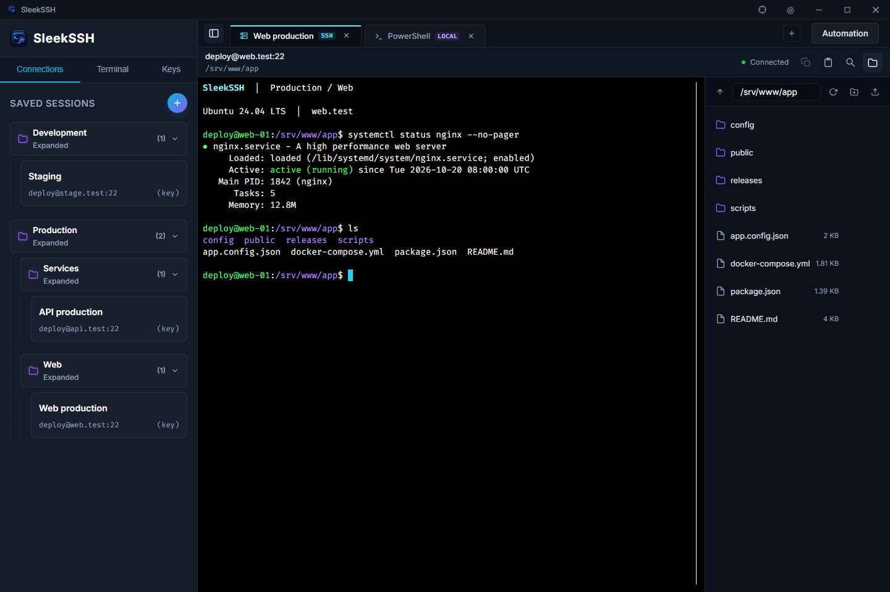
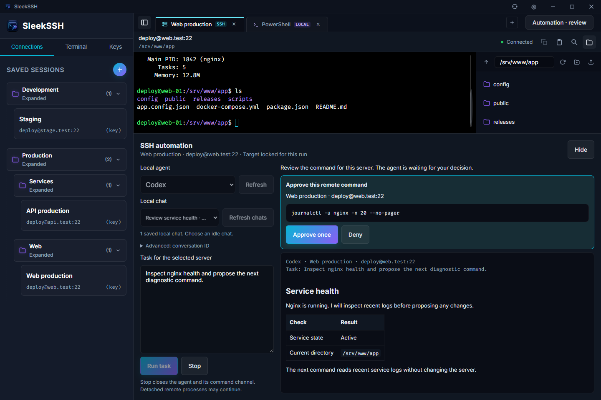

# SleekSSH

A Windows desktop workspace for SSH sessions, local terminals, SFTP, and command-by-command Claude Code or Codex automation.

<!-- Documentation owner: repository maintainers. Reviewed for v0.3.0 on 2026-10-27; review on every release. -->

## Quick start

1. Install **SleekSSH v0.3.0** for Windows x64: [MSI installer](https://github.com/thechandanbhagat/sleek-ssh/releases/download/v0.3.0/SleekSSH_0.3.0_x64_en-US.msi) or [EXE installer](https://github.com/thechandanbhagat/sleek-ssh/releases/download/v0.3.0/SleekSSH_0.3.0_x64-setup.exe).
2. Launch SleekSSH. In **Local shells**, open PowerShell or Command Prompt; use **Hosts** to add an SSH profile with your server, username, and password or private key.
3. For a new SSH server, compare its displayed fingerprint with a trusted source before accepting it.

While SleekSSH is running, **Ctrl+Alt+T** brings it forward and opens PowerShell. The app registers itself to launch at Windows startup.

See the [release notes](RELEASE_NOTES.md) and [all releases](https://github.com/thechandanbhagat/sleek-ssh/releases).

## Screenshots



The workspace uses sample connections, terminal output, and remote files.



The automation view uses a sample conversation and command approval.

## Your workspace

- **SSH and local terminals:** Keep remote sessions, PowerShell, and Command Prompt in separate tabs. Reconnect a disconnected SSH session from its terminal toolbar.
- **Saved PowerShell locations:** In **Local shells → Saved locations → Add location**, choose or enter a folder and save it with an optional name. Click the saved location to open PowerShell in that folder. Locations are remembered between app launches and can be edited or removed.
- **Hosts and layout:** Organize saved hosts in nested folders and filter them by name or address. Clicking a host that is already open switches to its tab; **Ctrl+click** opens another session. Folder collapse state, sidebar width, and SFTP pane width are remembered.
- **Command palette:** Press **Ctrl+Shift+P**, or click the search box in the title bar, to jump to hosts, shells, and tools. Type `user@host` or `user@host:port` to connect without saving; **Ctrl+Alt+N** opens the palette in quick connect mode.
- **Terminal controls:** Copy with **Ctrl+Shift+C**, paste with **Ctrl+Shift+V**, and search with **Ctrl+F**. A context menu also provides copy, paste, and selection controls.
- **SFTP:** Browse remote directories, upload and download files through native file dialogs, create folders, and delete remote files or directories.
- **SSH keys:** Discover private keys in `~/.ssh`, select a custom key, or generate a new keypair.
- **Optional Cisco VPN:** Enable **Cisco VPN switcher** in Settings; it is hidden by default. With Cisco Secure Client or AnyConnect installed, import profile shortcuts, switch connections, disconnect, and check status.

Saved connection and VPN credentials use Windows DPAPI encryption. SSH server trust is checked before authentication; a changed host key blocks the connection and displays both the saved and presented fingerprints.

### Saved sudo password

Edit a connection, save a **separate sudo password**, enable its shortcut, and reconnect. At a recognized standard Bash/Zsh sudo password prompt, press **F2 three times within two seconds** to submit it. The password is encrypted with Windows DPAPI.

## Claude Code and Codex automation

### Start a task

1. Install and authenticate Claude Code or Codex locally before starting SleekSSH. Use **Refresh** after installing a CLI; restart SleekSSH after changing PATH.
2. Connect to an SSH server, select its terminal tab, and open **Agent** from the session toolbar or the status bar.
3. Choose the provider, enter your task, and select **Run task** (or press **Ctrl+Enter**).
4. Review every proposed remote command and choose **Approve once** or **Deny**.

The CLI runs locally with its configured authentication; SleekSSH adds no OAuth sign-in. Neither CLI needs installing on the remote server, and SSH credentials are not passed to the CLI. This integration was verified with Claude Code **2.1.268** and Codex CLI **0.154.0**; older versions without the required isolation flags need updating.

Agent responses support Markdown headings, lists, tables, links, and code blocks. Remote command output stays literal and monospaced. Web and email links open in their default application; embedded HTML is displayed as text and images are not fetched.

### Resume local chats

Choose an idle saved conversation from **Local chat**, or select **New chat**. The list follows the selected provider and shows titles, project paths, and update times, newest first. **Refresh chats** reloads local metadata; **Advanced** allows manual UUID entry.

SleekSSH stores the CLI's returned conversation ID per server and provider and resumes it for later tasks. **New chat** clears that association without deleting CLI history. A saved ID remains selectable when absent from the latest listing. Conversation history stays with the CLI; SleekSSH stores only the IDs and uses a stable local application-data workspace.

Discovery reads metadata without starting a CLI, calling a model, or loading full conversations. Lists are limited to 200 chats, with a notice when discovery is partial. Use a conversation that is idle in other terminals. Resumption uses `claude --print --resume <UUID>` or `codex exec ... resume <UUID> -`; SleekSSH supplies its SSH bridge and command approvals on every invocation.

### Approve sudo use

Elevated commands are marked **[sudo]** during command approval. When a saved password is first needed, choose **Allow for this run** or **Deny**. Allowing uses the connection's enabled saved sudo password; configure it and reconnect before starting automation.

Later password requests in that run are handled automatically, while **each command still needs approval**. Passwordless or cached sudo does not load the saved password. Consent ends with the run or **Stop**. Missing, changed, or rejected credentials require fixing the connection profile and starting a new run.

Passwords stay inside the native app and are excluded from agent input, logs, and tool results. Automation does not support sudo authentication that requires an interactive terminal or additional factors.

### Execution limits

- One run can be active at a time. It uses the selected connection's authenticated SSH session through a local, per-run authenticated MCP bridge.
- The target stays fixed when tabs change. Disconnecting or reconnecting ends the run; start a new task for the new connection.
- Commands use separate noninteractive remote shells, so include an explicit `cd` when needed. Each command has a **120-second** limit and bounded output.
- Command approvals expire after **five minutes**, saved-password consent after **90 seconds**, and runs after **twenty minutes**.
- **Stop** terminates the local agent and closes its remote command channel. Detached remote processes may continue.

## Configuration

Set environment variables before launching SleekSSH.

| Variable | Default | Purpose |
| --- | --- | --- |
| `CLAUDE_CONFIG_DIR` | `~/.claude` | Root for Claude Code chat metadata discovery. |
| `CODEX_HOME` | `~/.codex` | Root for Codex chat metadata discovery. |
| `CISCO_VPNCLI_PATH` | Auto-detected | Optional full path to `vpncli.exe`; checked before installed Cisco locations and PATH. |

## Development

The current release targets **Windows x64**. Credential storage uses Windows DPAPI and local shells use Windows executables; macOS and Linux are not supported by this release.

Install **Node.js 22.18 or newer**, **stable Rust and Cargo**, and the [Windows Tauri prerequisites](https://v2.tauri.app/start/prerequisites/), including the C++ build tools and WebView2 runtime.

```powershell
git clone https://github.com/thechandanbhagat/sleek-ssh.git
cd sleek-ssh
npm ci
npm run tauri dev
```

Build installers:

```powershell
npm run tauri build
```

Run the frontend and Rust tests:

```powershell
npm test
cargo test --manifest-path src-tauri/Cargo.toml --lib
```

Both npm and Cargo Tauri commands automatically typecheck and compile the frontend before development or installer builds. You can also build installers with `cargo tauri build`. Generated files in `src/generated/` are ignored by Git and are rebuilt by these hooks.

The app uses **Tauri v2**, **Rust**, **Tokio**, and **ssh2**, with an HTML/CSS and JavaScript frontend, TypeScript automation modules, **xterm.js**, and **markdown-it**.

## License

This project is private/licensed for personal use. See the workspace configurations for details.
